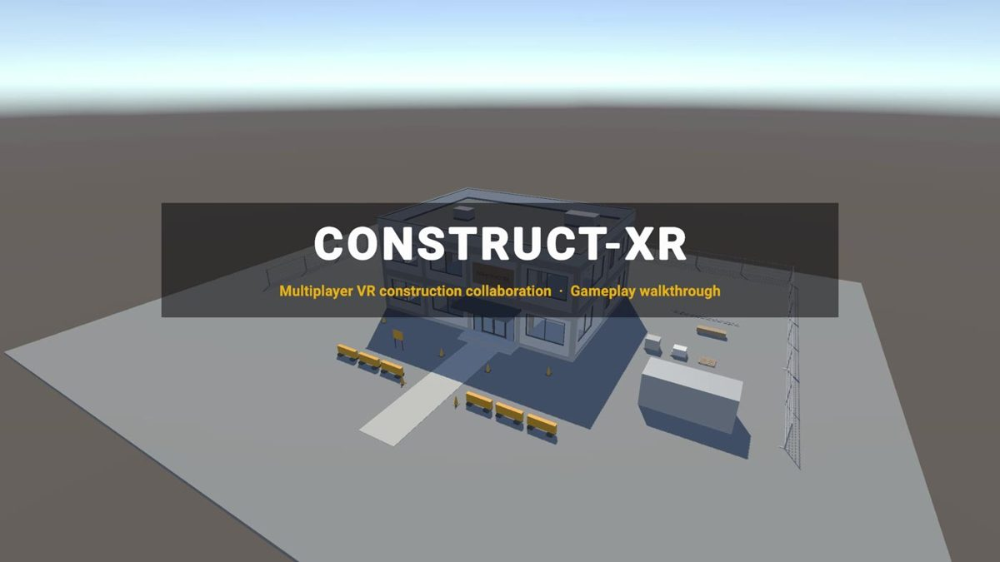
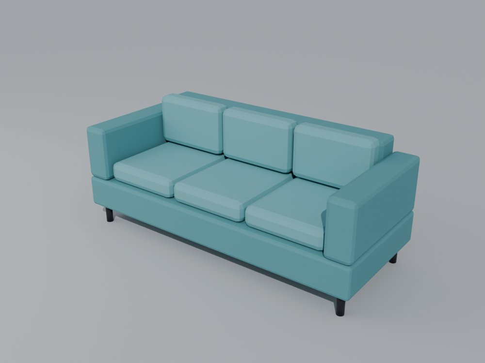
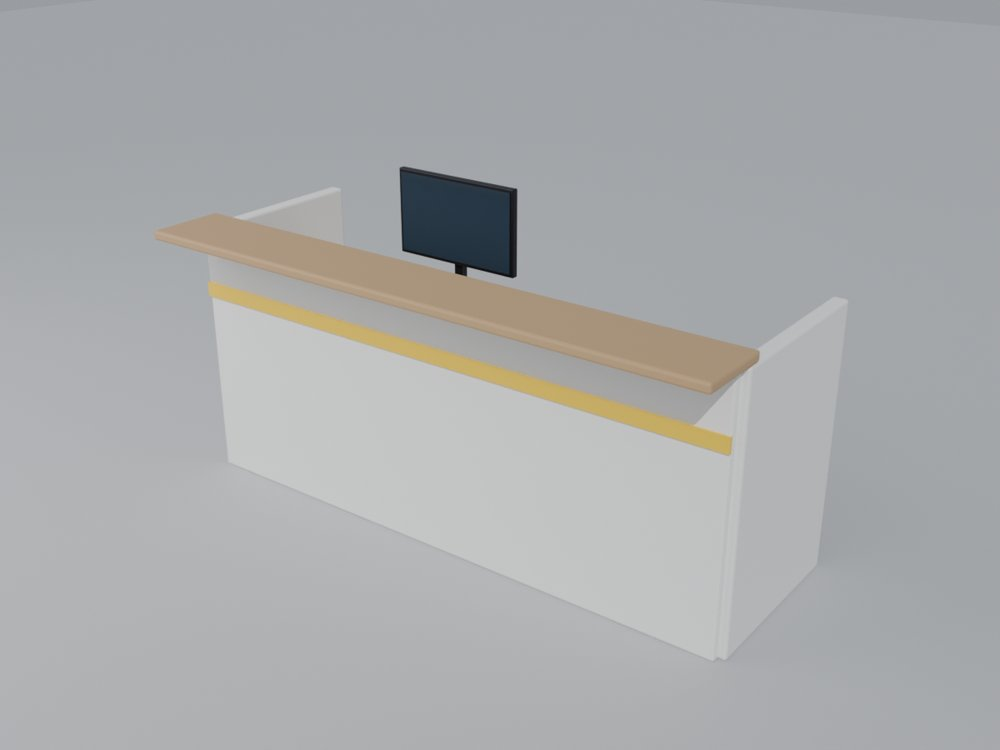
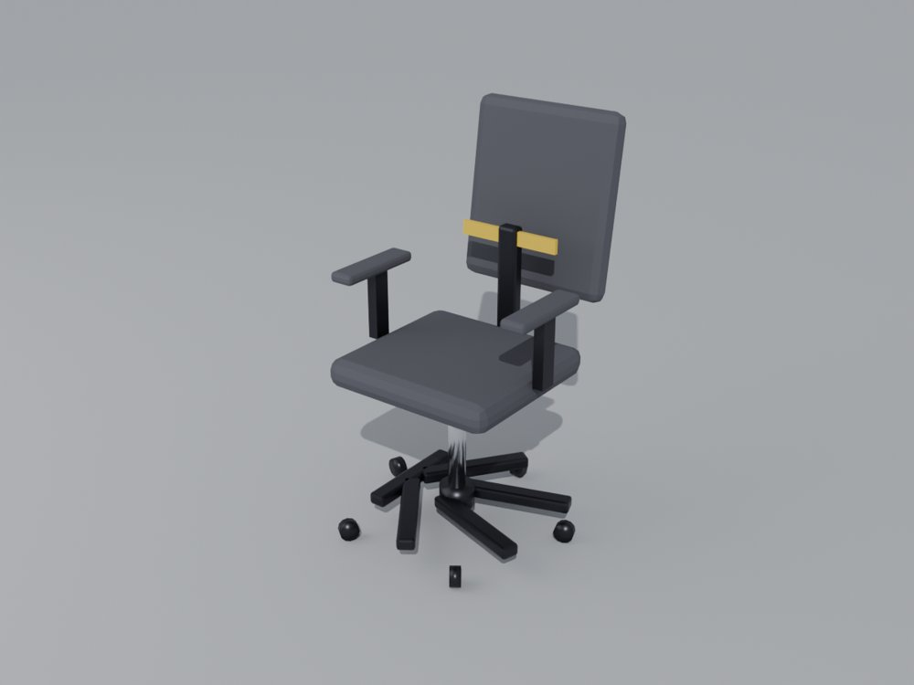
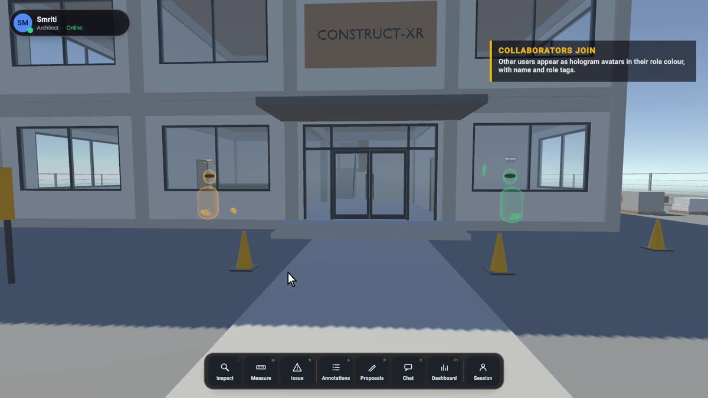
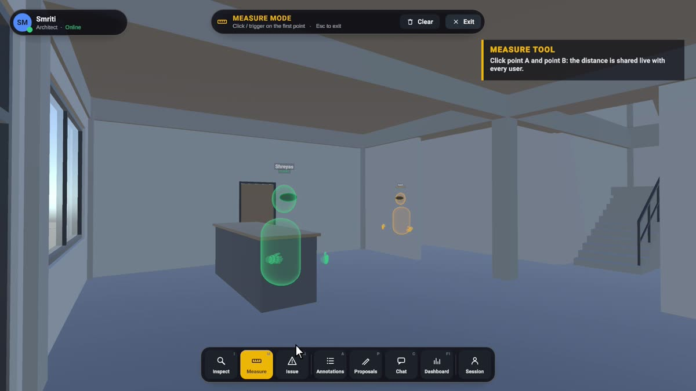
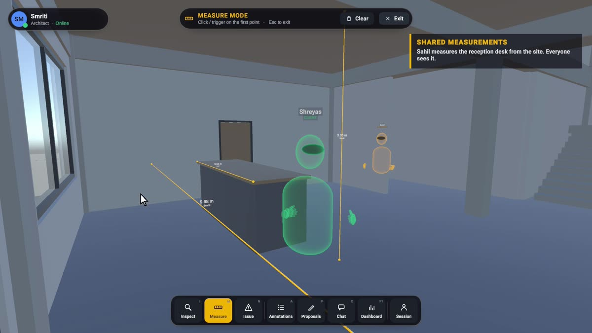
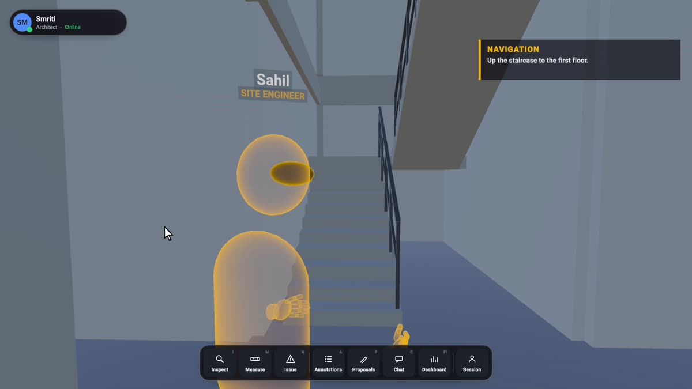
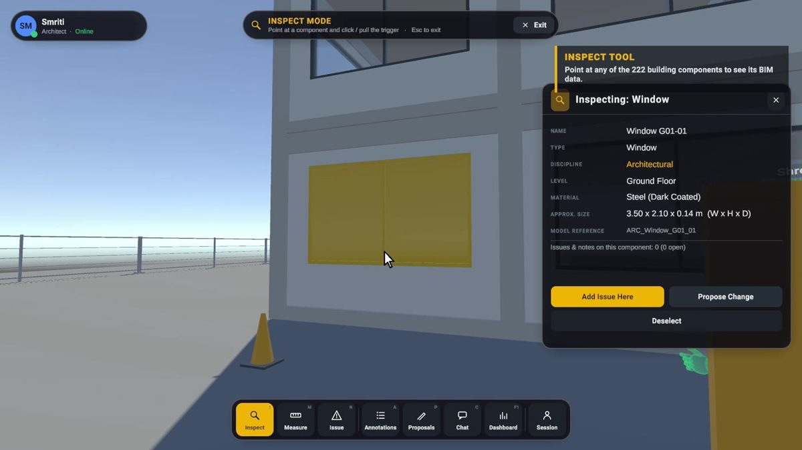
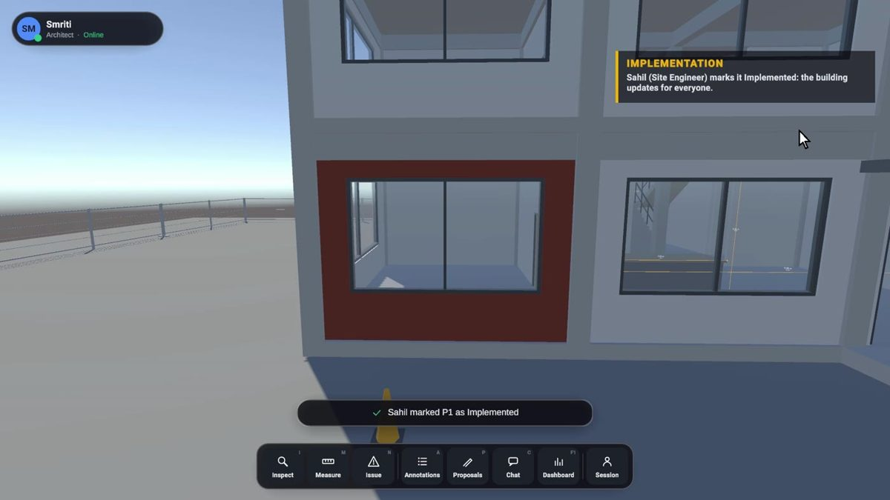

# CONSTRUCT-XR — Blender Building Model

3D model of the two-storey commercial building used in **CONSTRUCT-XR**, a multiplayer virtual reality app for construction design review on Meta Quest 3.

## Files

| File | Description |
|---|---|
| `models/CONSTRUCT-XR_Building.blend` | Blender file, with parts organised into collections by discipline |
| `models/CONSTRUCT-XR_Building.fbx` | FBX export used in the Unity VR project |
| `models/interior/INT_LobbySofa.blend` / `.fbx` | Three-seat lobby sofa |
| `models/interior/INT_ReceptionDesk.blend` / `.fbx` | Reception counter with work top, drawer pedestal and monitor |
| `models/interior/INT_OfficeChair.blend` / `.fbx` | Swivel office chair with five-star base and armrests |

## The model

- Modern two-storey commercial block, about 20 m × 15 m, flat roof with parapet, entrance canopy, lobby and internal staircase
- Built in real-world metres (Z up, ground at 0) so measurements in VR match the design
- **222 separate components**, each its own object, so every wall, window, beam or slab can be selected and inspected in VR
- Low-poly geometry with flat-colour materials, made to run smoothly on a stand-alone headset

| Prefix | Collection | Parts |
|---|---|---|
| `ARC_` | Architecture (walls, windows, doors, finishes) | 99 |
| `STR_` | Structure (columns, beams, floor slabs) | 77 |
| `SITE_` | Site works | 20 |
| `ENV_` | Site equipment (barriers, cones, site cabin) | 14 |
| `STA_` | Stairs | 7 |
| `ROOF_` | Roof | 5 |
| | **Total** | **222** |

Names follow the pattern `DISCIPLINE_Type_FloorNumber`, for example `ARC_Wall_G01_02` (architectural wall, ground floor, number 02).

## Interior props

Low-poly interior models for furnishing the lobby and offices. Each prop is a single parent object with separately named parts (`INT_` prefix), real-world scale, and flat materials matching the building.

| Lobby sofa | Reception desk | Office chair |
|---|---|---|
|  |  |  |
| 2.10 × 0.88 × 0.80 m | 2.40 × 0.75 × 1.12 m | 0.66 × 0.66 × 1.15 m |

## Human avatars

Each user in a session appears as a hologram avatar in their role colour, with a name and role tag above the head. Head and hands follow the user's headset and controllers, so you can see where teammates are standing, looking and pointing.

| Collaborators joining at the entrance | Two users in the lobby |
|---|---|
|  |  |
| **Measuring together** | **Name and role tag** |
|  |  |

## In the VR app

| Inspecting a component | Design change applied in VR |
|---|---|
|  |  |

## Team

- **Smriti N** — base building model
- **Shreyas Abiram Y R** — supporting site and interior models
- **Sahil Roshan** — human character models

RV University, School of Computer Science and Engineering — Mini Project (Virtual Reality & 3D Modelling with Blender), 2026.
